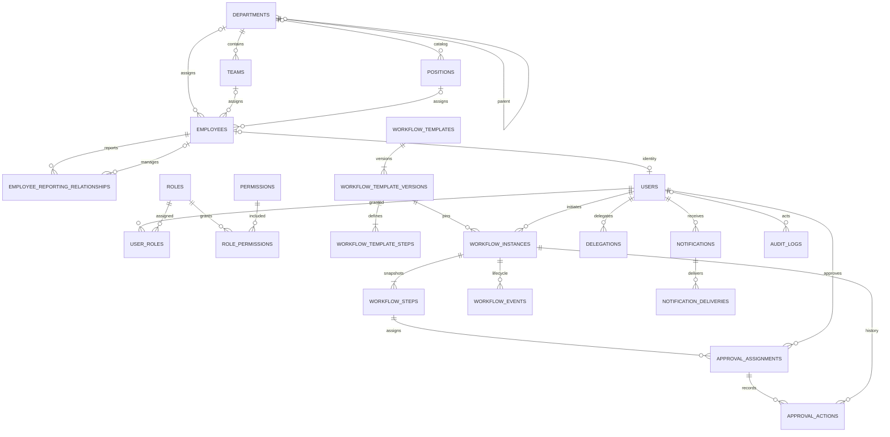
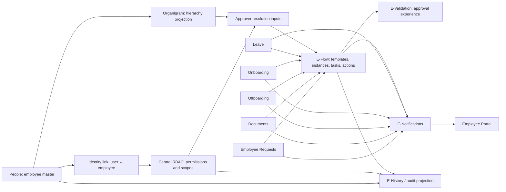

# IntilljHR Pre-Backend Architecture

**Status: Initial technical baseline approved; business rules and remaining architecture decisions stay proposed until stakeholder confirmation.**
**Scope:** People, Organigram, centralized RBAC, E-Flow/E-Validation, REST contracts, and frontend migration. This document remains the architecture baseline; implementation status and the approved technical choices are tracked below. Business rules are not finalized here.

This document elaborates the pre-backend roadmap in [AI_ROADMAP.md](./AI_ROADMAP.md). It supplements, and does not replace or finalize, [brd-text.txt](./brd-text.txt) or [brd-document.xml](./brd-document.xml). The BRD already requires module- and field-level RBAC, protection for sensitive data, no plaintext passwords, employee/manager self-service, notifications, and proposes reusing workflow concepts across Leave, Onboarding, and Offboarding. New E-Flow, Organigram, and role examples remain proposed until approved.

## 1. Current-state validation

- `src/types/models.ts` has numeric `Employee.id` and numeric `Employee.userId`; `LeaveRequest.userId` refers to the latter. Do not conflate employee and authentication IDs.
- Employee department and manager are display strings today. `Department.id` exists in seed data, but employees do not reference it. `jobTitle` is a string, not a position foreign key.
- `src/pages/people/PeoplePage.tsx` filters local imported mock employees by name/title/department/status, displays department and manager strings, and presents static summary/pagination values. It is not yet a server-paginated People service.
- `src/data/mock.ts` contains demo employees, departments, users, leave, onboarding, offboarding, and notification seeds. `src/data/employeeStore.ts` initializes selected collections from seeds and persists changes in browser localStorage. `src/data/mockRepository.ts` wraps selected collections in async list/get/create/update/delete interfaces; its query behavior is an adapter example, not an HTTP contract.
- `src/contexts/AuthContext.tsx` resolves demo users/employee email and uses a hardcoded demo password; session flags/user data are browser storage. `src/App.tsx` guards routes by frontend roles. These controls are not authoritative security and must not be promoted to production authentication.
- BRD detail: role/field restrictions are a stated requirement; exact access policy, approver rules, department structure, and workflow transitions are not defined. Its future-enhancement section explicitly suggests a reusable workflow engine. This plan respects existing HRMS journeys and does not invent approval policy.

## 2. Proposed domain model

### Identity and People

| Entity | Proposed key and relationships | Constraints / notes |
|--------|-------------------------------|---------------------|
| `users` | `user_id UUID PK`; optional unique `employee_id BIGINT FK employees.employee_id`; unique normalized login/email; external identity subject/provider when applicable | Authentication principals are separate from people records. A person may have no employee account; require at most one user per employee unless HR approves shared/multiple accounts. Store no plaintext password. |
| `employees` | `employee_id BIGINT PK`; existing numeric IDs preserved; `department_id UUID FK`; optional `team_id UUID FK`; optional `position_id UUID FK`; employment dates and status | Sole employee master. Do not duplicate employee profiles in Users, workflow requests, notifications, or organizational views. Existing `userId` values migrate to `users.user_id` links, not employee keys. |
| `departments` | `department_id UUID PK`; optional `parent_department_id UUID FK departments` | Unique code; parent relation must be acyclic if nested departments are approved. |
| `teams` | `team_id UUID PK`; `department_id UUID FK departments` | Unique code within department (proposed). |
| `positions` | `position_id UUID PK`; optional `department_id UUID FK departments`; optional `reports_to_position_id UUID FK positions` | Job title/position catalog. Position reporting is descriptive; employee reporting remains authoritative for actual org chart. |
| `employee_reporting_relationships` | `reporting_relationship_id UUID PK`; `employee_id BIGINT FK employees`; `manager_employee_id BIGINT FK employees`; `is_primary BOOLEAN`; `effective_from DATE`; nullable `effective_to DATE` | Canonical dated relationship source for Organigram and manager-based routing. Propose at most one active primary manager per employee; no self-reporting, no overlapping primary effective ranges, and no cycles in the effective current graph. No row means no assigned manager. Expose current `manager_id` as a derived API field; do not also store it on employees. |

**Employee lifecycle proposal:** Preserve existing `Active`, `On Leave`, `Suspended`, and `Terminated` during migration. Recommend treating employment status as `active`, `suspended`, `terminated` and leave as a separate leave/request state, while retaining a compatibility mapping for the current `On Leave` display. This is a proposal, not a change to current behavior; HR must approve effective-date, rehire, and inactive/archive rules.

**Identity rules:** Existing `Employee.id` remains the employee primary key during initial backend adoption. `Employee.userId` is mapped to an authentication `user_id` (recommend UUID) through a migration mapping table; employee references elsewhere are moved to `employee_id`. Existing demo user IDs are not credentials. Never match accounts by mutable email after the one-time reconciliation; use stable IDs.

### RBAC, workflows, and supporting records

| Entity | Proposed key and relationships | Constraints / notes |
|--------|-------------------------------|---------------------|
| `roles` | `role_id UUID PK`; unique `role_key`; name/description, active flag | Example names are seed suggestions only. No implicit inheritance. |
| `permissions` | `permission_id UUID PK`; unique `(module_key, action_key, resource_scope)` | Module/action catalog, with action examples `view`, `create`, `update`, `delete`, `approve`, `export`. Sensitivity/field scopes may be explicit permission attributes or policy rules. |
| `user_roles` | `(user_id, role_id) PK`, both FKs; optional assigning actor and validity timestamps | Many-to-many supports multiple roles; active assignment dates and audit every grant/revoke. |
| `role_permissions` | `(role_id, permission_id) PK`, both FKs | Role-to-permission mapping; changes audited. |
| `role_scope_assignments` | `scope_id UUID PK`; role/user assignment reference, scope kind and ID, validity | Proposed for department/team/self/resource boundaries. Exact scope semantics require approval; enforce server-side. |
| `workflow_templates` | `template_id UUID PK`; unique key and owning module | Stable identity for a family of definitions; not itself an executable published version. Module business rules remain outside the engine. |
| `workflow_template_versions` | `template_version_id UUID PK`; `template_id FK`; version number, status, publication time; unique `(template_id, version_number)` | Published version immutable; edits create a new version. |
| `workflow_template_steps` | `template_step_id UUID PK`; `template_version_id FK`; step key, sequence/group, mode, approver rule, completion rule | Steps may be sequential or parallel. Constraints are version-local; rule JSON must be schema-validated, not arbitrary executable code. |
| `workflow_instances` | `workflow_id UUID PK`; `template_version_id FK`; initiator `user_id FK`; generic `(resource_type, resource_id)`; status, timestamps, idempotency key | Instance pins exact version; unique active instance per resource/type only if the business process requires it; resource reference is polymorphic and checked by the owning module integration. |
| `workflow_steps` | `workflow_step_id UUID PK`; `workflow_id FK`; template-step reference; state/order/group | Instance snapshot of versioned step configuration, so template edits do not rewrite in-flight work. |
| `approval_assignments` | `assignment_id UUID PK`; `workflow_step_id FK`; approver `user_id FK`; optional source role/employee relationship; status | Snapshot the resolved approver and resolution context. Unique active assignment per task/approver as appropriate. Authorization is still rechecked at action time. |
| `approval_actions` | `action_id UUID PK`; `workflow_id`, `workflow_step_id`, `assignment_id` FKs; actor `user_id FK`; action, `occurred_at`, comment/evidence reference, idempotency key | Append-only decisions. Action restricted to authorized decision values; edits/retractions are compensating events, not history overwrites. |
| `workflow_events` | `event_id UUID PK`; `workflow_id FK`; optional actor `user_id FK`; event type, from/to state, `occurred_at`, correlation/idempotency key | Append-only lifecycle history for submission, step activation/completion, return, cancellation, and other state transitions; approval actions remain separately queryable decisions. |
| `delegations` | `delegation_id UUID PK`; delegator/delegate `user_id` FKs; optional role/assignment scope; start/end; creator | Require distinct users, valid interval, and non-overlapping active delegations for same scope (policy to confirm). Prevent self-delegation chains/cycles. |
| `notifications` | `notification_id UUID PK`; recipient `user_id FK`; type/template, resource reference, created/read timestamps, optional event dedupe key | In-app notification state. No copied employee profile or sensitive workflow content beyond the recipient's authorization. |
| `notification_deliveries` | `delivery_id UUID PK`; `notification_id FK`; channel, status, attempt timestamps | Optional channel/outbox delivery record; retries/idempotency key and retention to be decided. |
| `audit_logs` | `audit_id UUID PK`; actor `user_id FK` nullable for system actor; action, target/resource, outcome, `occurred_at`, correlation ID, structured redacted diff | Append-only to application roles; restricted read access. Record permission changes, reporting changes, workflow decisions, and security-relevant actions. |

**Document metadata:** Existing Documents is a module but has no managed file-storage backend. When needed, add `documents` and `document_versions` metadata/storage references with owner/resource/access classification. Keep bytes in private object storage. E-Signature needs a separate signature request/evidence record after provider and legal requirements are approved.

### Proposed indexes and referential actions

Names/types are logical; exact DDL is deferred until database vendor selection.

| Table | Proposed index / constraint | Query or integrity purpose |
|-------|-----------------------------|-----------------------------|
| `users` | Unique normalized login/email; unique nullable `employee_id`; unique `(identity_provider, external_subject)` when provider is used | Login lookup, one optional account link per employee, stable provider identity |
| `employees` | Index `(department_id, status)`, `(team_id, status)`, `(position_id, status)`; unique normalized email only if HR confirms it is a true identity key | Scoped directory filters without assuming email immutability |
| `employee_reporting_relationships` | Index `(employee_id, is_primary, effective_from, effective_to)` and `(manager_employee_id, effective_from, effective_to)`; partial unique active-primary index by `employee_id` where supported | Current manager and direct-report lookup; one active primary manager |
| `departments`, `teams`, `positions` | Unique catalog code; index each parent FK | Stable catalog identity and parent navigation |
| `user_roles` | PK `(user_id, role_id)`; reverse index `(role_id, user_id)`; index active validity columns as needed | Effective user roles and users assigned to a role |
| `role_permissions` | PK `(role_id, permission_id)`; reverse index `(permission_id, role_id)` | Permission resolution and role usage |
| `role_scope_assignments` | Index `(role_id, scope_kind, scope_id)` and `(user_id, scope_kind, scope_id)` plus validity | Scope evaluation; enforce referenced subject/scope integrity |
| `workflow_template_versions` | Unique `(template_id, version_number)`; index `(template_id, status)` | Immutable version lookup and publication |
| `workflow_template_steps` | Unique `(template_version_id, step_key)` and index `(template_version_id, sequence, group_key)` | Deterministic version step lookup and ordering |
| `workflow_instances` | Index `(status, created_at)`, `(resource_type, resource_id)`, `(initiator_user_id, created_at)`; unique idempotency key per initiator/resource operation | Queue/list, owning resource lookup, initiator listing, retry dedupe |
| `workflow_steps`, `approval_assignments` | Index `workflow_steps(workflow_id, sequence, status)`, `approval_assignments(approver_user_id, status, created_at)`, and assignment-to-step FK | Current workflow execution and approval inbox |
| `approval_actions` | Index `(workflow_id, occurred_at, action_id)`, `(actor_user_id, occurred_at)`; unique `(actor_user_id, idempotency_key)` where key is present | Stable history pagination and idempotent decisions |
| `workflow_events` | Index `(workflow_id, occurred_at, event_id)`; unique idempotency key per workflow command where present | Lifecycle history and command deduplication |
| `delegations` | Index `(delegator_user_id, starts_at, ends_at)`, `(delegate_user_id, starts_at, ends_at)` | Active delegation resolution |
| `notifications` | Index `(recipient_user_id, read_at, created_at)` and optional unique event/dedupe key | Unread recipient inbox and duplicate suppression |
| `notification_deliveries` | Index `(status, next_attempt_at)`; unique idempotency key per channel/event | Delivery worker retry and deduplication |
| `audit_logs` | Index `(target_type, target_id, occurred_at)`, `(actor_user_id, occurred_at)`, `(action, occurred_at)` | Restricted audit investigation and pagination |

Use restrictive foreign-key deletion by default for users, employees, roles, workflow history, and audit references. Prefer deactivation/end dates and anonymization under an approved retention policy over cascading deletion of HR or audit history. Close reporting relationships when they end; do not delete past relationship rows as a side effect of employee deactivation. Document all exceptions before DDL.

### Proposed entity relationship diagram

## 3. Organizational chart and integrity rules

The chart is a projection of Employees + Departments/Teams/Positions + currently effective primary reporting relationships; it is not a second employee hierarchy store. API nodes use stable employee IDs, manager IDs or `null`, and child IDs. Include employee card fields only when the caller may see them.

Cycle protection must be server-side and transactional:

1. Reject `employee_id == manager_employee_id`.
2. For a proposed active edge employee → manager, walk the manager's active primary chain; reject if it reaches the employee. Detect existing cycles before publishing a chart; report offending IDs and exclude cyclic edges rather than recurse indefinitely.
3. Enforce one active primary manager per employee and valid effective dates with a transaction/locking strategy; application-only checks are race-prone.
4. No manager is valid and represents a root/unassigned employee. Multiple roots are allowed. Secondary/matrix relationships are not in the first model unless approved.
5. Validate department/team consistency; a team must belong to the employee's assigned department. Historical reporting rows are immutable after use except controlled correction with audit.

## 4. Centralized authorization design

### Enforcement model

The server authenticates the principal, resolves active user roles and explicit permissions, evaluates resource/field scope, and authorizes every API operation. Frontend role-based navigation and control visibility are usability only. Deny by default, least privilege, validate object ownership and department scope from server-side records, and never trust client-supplied role, department, employee ID, or scope claims.

Use additive explicit roles for multiple-role users; no permission inheritance in the proposal. If user roles grant conflicting scopes, apply the narrower applicable scope and explicit denies only if a deny model is approved; absent any grant means deny. Sensitive data (national ID, passport, emergency contacts, salary-adjacent values) requires separate field permissions, redacted response DTOs, and protected export. Avoid returning restricted values and merely hiding them in React.

### Proposed permission matrix (illustrative defaults only)

| Proposed role | Own profile/requests | Department/team records | People directory/sensitive fields | Workflow decisions | RBAC administration |
|---------------|----------------------|--------------------------|-----------------------------------|--------------------|---------------------|
| Employee | Own permitted fields; submit/view own requests | None by default | No sensitive fields by default | Assigned tasks only when separately granted | None |
| Department Manager | Own + specifically approved team scope | Team scope, not whole department by default | Minimal fields; sensitive data denied | Only assigned/configured approvals | None |
| HR Manager | HR functions within explicitly assigned organization scope | Scope per grant | Sensitive fields only by explicit permission | Assigned/configured approvals | No role/permission administration by default |
| HR Admin | HR module access per approved permission catalog | Organization-wide only if granted | Sensitive field grants individually defined | Assigned/configured approvals | Role assignment only if separately granted |
| Workflow Approver | No extra People access | None by default | None | Assigned workflow/resource only | None |
| Super Admin (example) | No implicit HR data access | None absent data grant | No implicit sensitive-data access | No implicit approval authority | Platform administration per explicit grant |

Never grant approval authority solely from a role name or manager relationship. Approver assignment selects candidate users, while current RBAC permission and resource scope are independently checked on submission and decision. A manager can approve only where a confirmed workflow rule assigns them and server authorization permits that resource.

### Permission-change history

In one transaction, write the user-role/role-permission/scope change and an audit record with actor, target, before/after identifiers, reason if required, time, outcome, and correlation ID. Do not place credentials or unredacted sensitive values in diffs. Audit read/export access itself. Define retention, tamper-evidence, separation of duties, and break-glass handling before implementation.

## 5. E-Flow / E-Validation design

### Definition and approver resolution

- A workflow template consists of immutable published versions and ordered steps, each sequential or in a parallel group, with an approver rule and a completion policy. Rule configuration is declarative and allow-listed, not code execution.
- A workflow instance pins a template version and a generic owning-module resource key. It snapshots step configuration and resolved assignments; Leave/Onboarding/Offboarding/Documents/Employee Requests own their business record and invoke workflow commands through a stable integration contract.
- Proposed approver resolution precedence: explicit named approver(s) → users with configured role and resource scope → manager-chain rule based on effective reporting relationships → explicitly configured fallback queue. Each rule must declare behavior if it resolves zero or multiple eligible people; fail closed with a configuration error rather than silently selecting an arbitrary user.
- Snapshot assignment and relationship/role resolution context for history. At decision time, verify the authenticated actor, active assignment/delegation, current approval permission, resource scope, and workflow state. Policy on invalidating/reassigning pending assignments after role/org changes is an approval decision.
- Parallel completion policy (`all`, quorum, or first response), quorum counts, duplicate approver treatment, self-approval, delegation, and escalation remain unconfirmed. Do not infer these from a UI or a role.

### Proposed state model

```mermaid
stateDiagram-v2
  [*] --> Draft
  Draft --> PendingApproval: submit
  PendingApproval --> PendingApproval: step completed; next sequential step
  PendingApproval --> Approved: final step satisfied
  PendingApproval --> Rejected: reject
  PendingApproval --> ReturnedForCorrection: return
  ReturnedForCorrection --> Draft: resubmit (policy to confirm)
  Draft --> Cancelled: cancel (policy to confirm)
  PendingApproval --> Cancelled: cancel if permitted (policy to confirm)
  Approved --> [*]
  Rejected --> [*]
  Cancelled --> [*]
```

State names/edges are proposed. Every accepted command creates an immutable approval action/history event and audit entry in the same transaction as the state change; duplicate requests use an idempotency key. Invalid state transitions return a conflict error. Return-for-correction is not rejection; whether resubmission creates a new instance or another cycle in the same instance requires approval.

### Integration boundaries

| Owning module | Resource sent to E-Flow | Example event/behavior (not business policy) |
|---------------|-------------------------|---------------------------------------------|
| Leave Management | `leave_request` + stable leave request ID | Request submitted → workflow assigned; decision returned to Leave through an idempotent event/command |
| Onboarding | onboarding request/task ID | A configured stage can invoke approval; existing onboarding business record remains owned by Onboarding |
| Offboarding | offboarding request/task ID | Configured approval/asset step can invoke E-Flow; module retains offboarding facts |
| Documents | document/version ID | Circulation/approval references protected document metadata; bytes stay in document storage |
| Employee Requests | request ID/type | Request module owns request payload; workflow holds generic reference and approvals |

Avoid synchronous cross-module table writes. Recommend transactional outbox/event delivery after database choice is approved; consumers must be idempotent. E-Notifications consumes workflow/module events, resolves recipient user IDs, and delivers in-app first, with additional channels only after approval. E-History reads workflow actions and audit events under separate access checks; it does not become a second mutable workflow store.

## 6. REST API proposal

All routes below are illustrative `/api/v1` contracts. JSON examples are wire DTOs, not current TypeScript model changes. Authenticate every private request. `employeeId` is numeric; `userId`, role, workflow, and other new IDs use UUID in this proposal. Never accept user/role identity as authority from the request body.

### Common contract

- Lists accept `page` (1-based), `pageSize` (proposed default 25, maximum 100), allow-listed `sort`, `order`, `q`, and named filters. Response: `{ "data": [], "page": 1, "pageSize": 25, "total": 0 }`. Cursor pagination is an alternative to confirm if result size/performance requires it.
- Validate types, lengths, enums, referential integrity, business invariants, and allow-listed filters/sorts on the server. Use `ETag`/`If-Match` or a version field for concurrent updates. Never mass-assign protected fields.
- Error body: `{ "error": { "code": "VALIDATION_FAILED", "message": "Request validation failed.", "details": [{ "field": "managerId", "code": "CIRCULAR_REPORTING", "message": "Reporting relationship would create a cycle." }], "requestId": "..." } }`. Do not leak sensitive record existence or internal stack traces.
- Status conventions: `400` malformed query/body; `401` unauthenticated; `403` not authorized; `404` unavailable/not visible; `409` conflict, stale version, duplicate/cycle/invalid transition; `422` domain validation; `429` rate limited; `5xx` unexpected service failure with request ID. Exact envelope and status mapping require API review.
- Enforce permissions on server for list, detail, export, field projection, and mutations. Return only authorized fields. Denied object access should not reveal whether inaccessible records exist.

### Authentication and identity

| Method / path | Request → response | Authorization |
|---------------|--------------------|---------------|
| `POST /auth/session` | `{ providerToken? }` → `{ user, employee?, permissions, expiresAt }` | Public entry; verify credentials/provider server-side. Prefer external OIDC; do not accept the demo password pattern. |
| `GET /auth/session` | — → current principal, employee link, permission summary | Valid session |
| `DELETE /auth/session` | — → `204` | Authenticated; revoke/expire session |
| `GET /me` | — → stable user identity and permitted employee summary | Authenticated |

Cookie vs bearer token, OIDC provider, MFA, session duration/rotation/revocation, CSRF requirements, and account recovery are PROPOSED choices for approval. Prefer secure HttpOnly, Secure, SameSite cookies for a same-origin web application if deployment supports them.

### People and Organigram

| Method / path | Request / filters | Response and authorization |
|---------------|-------------------|----------------------------|
| `GET /employees` | `q`, `departmentId`, `teamId`, `positionId`, `managerId`, `status`, pagination/sort | Paginated authorized employee summaries; requires `people.employee.view` and server scope filtering |
| `POST /employees` | Employee profile and canonical relationship IDs; no client ID/permission fields | `201 { data: employee }`; requires `people.employee.create`; validate unique identifiers and FKs |
| `GET /employees/{employeeId}` | — | Authorized projected employee; `people.employee.view`, field scopes |
| `PATCH /employees/{employeeId}` | Partial allow-listed fields + version/If-Match | Updated DTO; `people.employee.update` plus field and record scope; validate cycles/department-team consistency transactionally |
| `DELETE /employees/{employeeId}` | — | Prefer lifecycle deactivation rather than hard deletion; requires explicit HR permission and referential checks if deletion is approved |
| `GET /departments`, `GET /teams`, `GET /positions` | pagination/search/active | Catalogs filtered by permissions |
| `GET /org-chart` | `rootEmployeeId?`, `departmentId?`, `q?`, `depth?` | `{ data: [{ employeeId, managerId, department, position, children? }] }`; caller-visible fields only; `organigram.view`, same data scope as People |
| `PUT /employees/{employeeId}/reporting-relationships` | `{ managerEmployeeId, effectiveFrom, effectiveTo?, isPrimary }` | Created relationship; `people.reporting.update`; reject self/cycles/overlap and audit the old/new relation |

People request validation rejects unknown catalog IDs, inconsistent team/department, illegal status/date combinations, duplicate stable identity links, unauthorized field updates, and reporting cycles. Search and chart filters never bypass data-scope constraints.

### Roles & Permissions

| Method / path | Request / filters | Response and authorization |
|---------------|-------------------|----------------------------|
| `GET /roles`, `POST /roles` | Search/page; create `{ key, name, description }` | Role list/created role; `rbac.role.view` / `rbac.role.create` |
| `GET /roles/{roleId}`, `PATCH /roles/{roleId}` | Partial metadata and concurrency version | Role; `rbac.role.view` / `rbac.role.update` |
| `GET /permissions` | `module`, `action`, page | Permission catalog; `rbac.permission.view` |
| `PUT /roles/{roleId}/permissions` | `{ permissionIds: [...] }` | Current assignment set; `rbac.role_permission.assign`; validate IDs, scope policy, and audit atomically |
| `GET /users/{userId}/roles`, `PUT /users/{userId}/roles` | `{ roleIds: [...] , scopeAssignments?: [...] }` | Assignments; `rbac.user_role.view` / `rbac.user_role.assign`; self-escalation and separation-of-duty policy required |
| `GET /me/permissions` | Optional module filter | Effective non-sensitive permission summary for UI; never an enforcement token |

All RBAC changes require a privileged server-side grant and audit event. Validate that the acting admin retains an authorized recovery/admin path; avoid locking out every administrator. Exact approval/separation-of-duty rules need approval.

### E-Flow and E-Validation

| Method / path | Request / filters | Response and authorization |
|---------------|-------------------|----------------------------|
| `GET /workflow-templates`, `POST /workflow-templates` | Search/filter; `{ key, module, resourceType, name }` | Template; `workflow.template.view/create` |
| `POST /workflow-templates/{templateId}/versions` | `{ steps: [{ key, sequence, mode, approverRule, completionRule }] }` | Draft immutable version; validate rule schema, unique keys, reachable steps, supported transitions; `workflow.template.update` |
| `POST /workflow-template-versions/{versionId}/publish` | `{ expectedVersion }` | Published immutable version; `workflow.template.publish` |
| `POST /workflow-instances` | `{ templateVersionId, resourceType, resourceId, idempotencyKey }` | `201` instance and resolved tasks; `workflow.instance.start` plus resource-specific permission and resource ownership validation |
| `GET /workflow-instances` | `mine`, `assignedToMe`, `resourceType`, `status`, `from`, `to`, page | Scoped paginated instances; `workflow.instance.view` |
| `GET /workflow-instances/{workflowId}` | — | Instance, authorized resource summary and history; scoped `workflow.instance.view` |
| `POST /workflow-instances/{workflowId}/actions` | `{ assignmentId, action: "approve"|"reject"|"return", comment?, idempotencyKey }` + If-Match | Updated state/action; `workflow.approve` and assigned/delegated/current scope validation; conflict on stale/invalid transition |
| `POST /workflow-assignments/{assignmentId}/delegations` | `{ delegateUserId, startsAt, endsAt }` | Delegation record; `workflow.delegate`; enforce approved scope/interval/no-cycle policy |
| `GET /workflow-instances/{workflowId}/history` | pagination | Append-only history; `workflow.history.view` + resource scope |

An action payload cannot choose its actor, final status, approval permission, or arbitrary next state. Resolve those server-side from the authenticated principal, assignment, configured transition, active delegation, and current resource state. Validate comment length, action, assignment ownership, state version, idempotency key, and any resource-specific criteria.

### Notifications and audit

| Method / path | Request / filters | Response and authorization |
|---------------|-------------------|----------------------------|
| `GET /notifications` | `unread`, `type`, pagination | Current user's notification page only; `notification.view` |
| `PATCH /notifications/{notificationId}` | `{ read: true }` | Updated read state; recipient-only or explicit support permission |
| `POST /notifications/read` | `{ notificationIds: [...] }` | Updated count; only current user's IDs |
| `GET /audit-logs` | actor, target type/id, action, date, pagination | Restricted and field-redacted; `audit.view`; no general employee access |

Notifications should be generated from committed domain events, deduplicated, and delivered asynchronously where external channels are approved. Audit records are not user-editable; audit export is separately permissioned.

## 7. Frontend/API integration and migration

1. **Shared contract types:** After API agreement, introduce API DTOs separately from UI models, e.g. `EmployeeSummary`, `EmployeeDetail`, `OrgChartNode`, `UserIdentity`, `Permission`, `WorkflowInstance`, and discriminated `ApiError`. Map to existing UI models in service adapters. Keep `employeeId` and `userId` different types/fields; do not immediately widen the current model or change pages in this planning task.
2. **Repository boundary:** Generalize the existing repository interface (list/get/create/update/delete) into typed services for People, Leave, Onboarding, Offboarding, Documents, RBAC, workflows, and notifications. Use query/response envelopes and explicit service errors. Page components call services/hooks, not localStorage or `fetch` directly.
3. **Auth:** Replace demo auth in a separate implementation phase with server session bootstrap (`GET /auth/session`), login/logout, expiration/401 handling, and permission summary for UI. Server checks remain authoritative; UI may hide unavailable actions but handles `403` errors.
4. **UX states:** Standardize loading/skeleton, empty, validation, retryable network error, permission denied, stale version/conflict, and success states. Preserve existing routes, employee self-service scoping, EN/FR/AR, RTL, dark/light themes, leave calculations, and current business behavior while replacing adapters.
5. **Data export/reconciliation before cutover:** Inventory every localStorage key and record ownership, distinguish seeded/demo data from user-created data, export a dated backup, dry-run transform with counts and duplicate/orphan/error report, review ambiguous department/manager strings, and require explicit approval before import. Never import demo credentials/session flags. Do not fabricate missing history.
6. **Preserve local changes:** Keep source localStorage read-only through initial API verification; reconcile concurrent local/server edits with a documented field-level conflict policy. Import idempotently with source IDs and migration ledger. Verify record counts/references, user-to-employee mapping, authorization scopes, and representative module journeys. Retain backup and tested rollback until acceptance.
7. **Progressive cutover:** Introduce API-backed repository behind the same UI interface; cut over one module at a time. Mock adapter remains for tests/demo only, selected explicitly by configuration—not as a silent production fallback. Surface network/API errors; never report success from a stale local fallback.

## 8. Module dependency boundaries

One-way ownership contracts prevent circular dependencies: module business record → workflow resource reference → workflow event → notification/employee portal. RBAC is a shared service, not a set of cross-module role checks in page components. Organigram consumes People; People does not call Organigram.

## 9. Proposed implementation order

1. Approve identity, organization, data-scope, workflow, and hosting decisions; baseline BRD traceability.
2. Define employee/user mapping, department/team/position catalogs, dated reporting data, lifecycle/status policy, constraints, and migration rehearsal.
3. Implement backend authentication/session and centrally enforced RBAC before protected API rollout; add field-scope and authorization tests.
4. Deliver People API and Organigram projection; validate cycle/race protections and no-manager roots.
5. Implement workflow template/version/instance/task/action engine, audit/outbox, and state-machine tests.
6. Deliver E-Validation and approver-resolution/delegation policies; integrate Leave, Onboarding, Offboarding, Documents, and Employee Requests one at a time.
7. Add notification delivery and employee portal integration; add document/signature services only after storage/legal decisions.
8. Migrate reviewed data, cut over repositories, then pass security, privacy, recovery, regression, and deployment gates.

This refines the ten phases in `AI_ROADMAP.md`; backend implementation remains its Phase 9 and starts only after architecture and required policies are approved.

## 10. Architecture decisions requiring approval

Every recommendation below is **PROPOSED**, not finalized.

| Decision | Options | Recommendation | Consequences |
|----------|---------|----------------|--------------|
| Employee vs authentication identity | Combine account and person; separate user table with optional employee link | **PROPOSED:** Separate `users` from `employees`, optional unique employee link | Supports non-employee admins and secure identity lifecycle; requires one-time mapping of existing `userId` values |
| Employee primary key | Replace with UUID; preserve existing numeric `Employee.id` | **PROPOSED:** Preserve numeric employee IDs; use UUID for new entity IDs | Least disruptive to mock IDs/current `EMP-{id}` UI and legacy references; new backend sequence must preserve imported IDs |
| Department/team/job title | Keep display strings; normalize catalogs | **PROPOSED:** Normalize Departments, Teams, Positions and reference IDs | Enables filters/data scopes/org chart; requires reviewed string-to-ID migration, ambiguous entries block import |
| Reporting structure | Manager column only; dated relationship table; matrix graph | **PROPOSED:** Dated direct-report table with one active primary manager and no secondary edges initially | Supports history and snapshots; query/index/transaction complexity; matrix reporting deferred |
| `On Leave` status | Employment status; separate leave state | **PROPOSED:** Keep compatibility mapping now; define lifecycle as active/suspended/terminated, leave as a separate process | Avoids changing employment identity on temporary leave; requires UI/filter translation and HR approval |
| Authentication | Local passwords; external identity; hybrid | **APPROVED INITIAL BASELINE:** Laravel Sanctum stateful HTTP-only SPA session with CSRF protection; never migrate demo passwords | Laravel session configuration is implemented; production IdP, MFA, account recovery, and deployment origins remain open |
| Role model | Single role; additive roles; role inheritance | **PROPOSED:** Multiple additive roles, explicit permissions, no inheritance | Simple effective-permission model; overlaps need union/scope conflict rules; no hierarchy semantics |
| Data scope | Global role grants; self/team/department/resource scopes | **PROPOSED:** Permission plus explicit server-side scope assignment, default deny | More policy/test work; prevents role membership alone exposing organization-wide employee data |
| Sensitive fields | Broad employee read; field-level permissions | **PROPOSED:** Separate field-level grants and response projection for national ID/passport/emergency/salary-adjacent data | Requires endpoint DTO discipline and export controls; exact authorized roles/fields need HR approval |
| Reporting history | Overwrite manager link; effective-dated history | **PROPOSED:** Effective-dated immutable reporting relationships | Reproducible org/approval context; correction and date overlap policy required |
| Approver resolution | Named users; role; manager chain; fallback | **PROPOSED:** Allow explicit configured strategies in order with fail-closed unresolved cases | Flexible engine and explainable task history; who configures order, multi-match, and no-match handling require approval |
| Approval assignment changes | Preserve assignment; recalculate live on every decision | **PROPOSED:** Snapshot assignee on task creation; recheck current authorization on action; explicit audited reassignment only | Stable history without stale authorization; define response to role/org/deactivation changes for pending tasks |
| Parallel completion | All; first; quorum | **PROPOSED:** Make a required completion rule explicit per template step; no implicit default | Supports both sequential and parallel flows but each workflow needs an approved rule; quorum/self-approval remain open |
| Return and resubmission | Same instance cycle; new instance; terminal return | **PROPOSED:** `ReturnedForCorrection` state and explicit resubmit command, with cycle policy unresolved | Keeps correction distinct from rejection; requires decision on instance/history continuity |
| REST pagination | Offset/page; cursor | **PROPOSED:** Page/pageSize first, capped at 100; cursor if scale/performance requires | Matches current mock repository and UI; offset can shift during concurrent writes |
| API errors | Ad-hoc; common envelope | **PROPOSED:** Stable machine code, safe message, field details, request ID | Predictable UI validation/retry; clients must not depend on message text |
| Files and signatures | DB blobs; protected object storage; provider-managed files | **PROPOSED:** Metadata in relational DB, private object storage; external e-sign provider evaluated separately | Adds storage/scanning/access lifecycle; region, retention, provider/legal validity need approval |
| Workflow side effects | Direct cross-module calls; event/outbox | **PROPOSED:** Owning module contracts plus transactional outbox and idempotent consumers | Avoids table coupling and lost notifications; introduces queue/retry/operations choices |
| Database/deployment | Select specific stack now; defer to constraints review | **APPROVED INITIAL BASELINE:** PostgreSQL with relational FKs, unique constraints, and transactions | Local PostgreSQL `intelligence_rh` connection, migrations, and catalog seeding are verified; the feature-test suite still uses SQLite; hosting, backup, and residency stay open |
| Local data migration | Discard localStorage; import all; reviewed selective migration | **PROPOSED:** Backup + inventory + dry-run selective import + approval + rollback | Preserves legitimate edits and avoids demo contamination; local records need ownership reconciliation |
| Audit retention | Mutable log; append-only events; immutable external archive | **PROPOSED:** Application append-only audit with restricted access, retention/redaction policy and tamper-evidence decision before production | Strong accountability; storage cost, privacy, legal retention and archival mechanism need approval |

## 11. Validation outcome and gates

| Area | Assessment |
|------|------------|
| BRD consistency | **Validated at architecture level:** preserves existing People, manager/self-service, module/field RBAC, credential, notification, and reusable-workflow direction; leaves new approval business rules proposed |
| People | **Proposed model validated:** one employee entity; employee ID remains distinct from authentication user ID |
| Organigram | **Proposed model validated:** projection over shared employees and dated reporting relationships; roots supported; server-side cycle prevention |
| RBAC | **Proposed model validated:** centralized server enforcement, multiple roles, explicit actions/scopes/field permissions, audited changes |
| E-Flow | **Proposed model validated:** separate engine/resource ownership, versioned templates, explicit tasks/actions, resolved assignments, history and module contracts |
| Database | **Designed and implemented baseline:** normalized PostgreSQL entities, keys, FKs, constraints, and indexes; local migrations and catalog seeding verified |
| API | **Specified, proposed:** versioned REST resource shapes, DTOs, pagination, errors, validation, and server authorization |
| Circular dependencies | **No module cycle designed:** People → Organigram; RBAC shared; HR modules call workflow by resource contract; notifications/history consume events |
| Frontend compatibility | **Compatible by adapter plan:** retains current UI models/routes during service migration and explicitly maps employee vs user IDs |
| Backend | **In progress:** initial Laravel migrations, auth, People/catalog, RBAC, Organigram, notifications, and workflow APIs implemented; PostgreSQL is connected and migrations/seeding pass; feature tests pass on SQLite |

## 12. Implementation status and verification

The stack choices above are approved as the initial baseline. Proposed business policies are not approved by this code and remain subject to the BRD and stakeholder decisions.

- Backend location: `backend/`; REST prefix: `/api/v1`.
- Authentication: `POST /auth/login`, `POST /auth/logout`, `GET /auth/me`; Sanctum stateful session cookies and CSRF.
- Implemented routes also cover `/employees`, `/departments`, `/teams`, `/positions`, `/org-chart`, `/roles`, `/permissions`, `/users/{user}/roles`, `/workflow-templates`, `/workflow-instances`, `/notifications`, and `/audit-logs`.
- Initial migration set includes users, employees, normalized organization catalogs, dated reporting relationships, RBAC/scope assignments, audit logs, notifications, workflow templates/versions/instances/steps/assignments/actions/events, delegations, and notification delivery metadata.
- The API enforces permissions and data scopes server-side; UI role routing is not an authorization boundary. The bootstrap administrator is provisioned interactively and receives only RBAC/audit permissions.
- Workflow decisions support configured sequential/parallel approval steps, explicit completion rules, approve/reject/return, assigned-approver checks, and history. Delegation, business-policy transitions, and owning-module updates remain pending confirmation.
- React uses `VITE_DATA_MODE=mock` by default. `VITE_DATA_MODE=api` enables the Sanctum auth adapter and People-directory service; other modules remain on mock storage pending their own verified adapters. No localStorage records are imported or deleted.
- Validation: PostgreSQL connection, all six migrations, required-table presence, and repeat catalog seeding verified; backend tests pass (21 tests, 100 assertions) on the configured in-memory SQLite database; frontend TypeScript, lint, and production build pass. PostgreSQL-specific feature-test coverage remains pending.

Continue approved, independent work, but stop before turning proposed employee lifecycle, approver/delegation, signature, retention, and data-migration policies into enforced business rules. Resolve those items with HR before E-Validation production integration or bulk migration.
